  

I build modern web applications with a strong focus on frontend, and backend services and APIs with Node.js, NestJS and GraphQL. 
I've worked on products in <b>healthcare</b>, <b>employee benefits</b> and <b>recruitment</b>, and I use AI tools to support code analysis, refactoring and problem-solving.

 

## 🚀 What I'm working on

- 🏥 **Full Stack Developer at Dasa**, one of Brazil's largest healthcare companies: GraphQL APIs, authentication, patient registration and data validation services
- 🩺 Previously built the frontend of a platform that let doctors **remotely adjust home respiratory devices** (BiPAP)
- 🎓 Technologist Degree in **Systems Analysis and Development** (UNINTER)
- 🌍 Practicing my English and open to **remote opportunities with international teams**

 

## 🛠️ Tech Stack

<table align="center"><tr>
<td valign="top" width="33%">

<h3 align="center">Frontend</h3>

</td>
<td valign="top" width="33%">

<h3 align="center">Backend</h3>

</td>
<td valign="top" width="33%">

<h3 align="center">Cloud & DevOps</h3>

</td>
</tr></table>

<b>Tools:</b> 

 

## 📊 GitHub Stats

  

  
  

> 💼 Most of my professional work lives in private company repositories, so my public activity here doesn't reflect my day-to-day coding.

 

## 🐍 Contribution Snake

  <picture>
    <source media="(prefers-color-scheme: dark)" srcset="https://raw.githubusercontent.com/keelbuzato/keelbuzato/output/github-snake-dark.svg" />
    <source media="(prefers-color-scheme: light)" srcset="https://raw.githubusercontent.com/keelbuzato/keelbuzato/output/github-snake.svg" />
    
  </picture>

 

## 📫 Let's connect

I'm always happy to talk about frontend, React, healthcare tech or remote work. 
Feel free to reach out on <a href="https://www.linkedin.com/in/raquel-buzato/">LinkedIn</a>!

